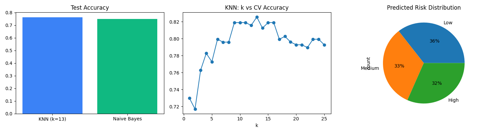

# Student Academic Performance Prediction: KNN vs Naive Bayes

> An interactive early-warning system that predicts Low / Medium / High academic performance using KNN and Naive Bayes.

## Live Application

**Live Demo:** https://student-performance-knn-naive-bayes.streamlit.app/

This project includes an interactive web application developed using Streamlit.

## Aim

To build and compare K-Nearest Neighbours (KNN) and Naive Bayes classifiers that predict student performance bands (Low / Medium / High) from absences, study time, failures and earlier grades, and to deliver the results as an interactive early-warning application for mentors.

## Problem Statement

Many students fall behind academically before anyone notices. This project builds a machine learning model to identify at-risk students early, so mentors can take timely action.

## Features

- Data cleaning: duplicate removal, missing value handling and outlier capping.
- Final grade (G3) classified into Low / Medium / High performance bands.
- KNN and Gaussian Naive Bayes models with feature scaling.
- 5-fold cross-validation and KNN k tuning.
- Model selection using cross-validation.
- Accuracy, classification reports and confusion matrices.
- Interactive Streamlit web application.
- Student performance prediction with probabilities.
- CSV dataset upload for predictions and model training on supported numeric datasets.
- At-risk student identification and ranking.
- Downloadable mentor alerts CSV.
- Interactive charts and model comparison.

## Dataset

**Student Performance Dataset** (math course, secondary school survey, 395 students) from Kaggle, by Dev Ansodariya:

https://www.kaggle.com/datasets/devansodariya/student-performance-data

File used: `student_data.csv`

| Column | Description |
|---|---|
| absences | Number of school absences |
| studytime | Weekly study time (1 to 4) |
| failures | Number of past class failures |
| G1 | First period grade (0 to 20) |
| G2 | Second period grade (0 to 20) |
| G3 | Final grade (0 to 20), used to create target bands |

## Tech Stack

- Python
- Pandas
- NumPy
- Scikit-learn
- Matplotlib
- Streamlit

## Project Structure

```text
├── app.py
├── requirements.txt
├── student_performance_knn_nb.py
├── student_data.csv
├── mentor_alerts.csv
├── mentor_dashboard.png
└── README.md
```

## Installation

Clone the repository:

```bash
git clone https://github.com/Fathima1616/student-performance-knn-naive-bayes.git

cd student-performance-knn-naive-bayes
```

Install dependencies:

```bash
pip install -r requirements.txt
```

## Run the Web Application Locally

```bash
streamlit run app.py
```

The application opens in your browser at:

```text
http://localhost:8501
```

## Application Modules

### 1. Results
- KNN and Naive Bayes accuracy comparison.
- Model performance charts.
- Confusion matrices.
- Performance band information.

### 2. Predict a Student
- Enter student academic details.
- Select a machine learning model.
- Predict Low / Medium / High performance.
- View prediction probabilities.

### 3. At-Risk Students
- Identify students predicted as Low performers.
- Rank students based on risk probability.
- Download mentor alerts as CSV.

### 4. About
- Dataset information.
- Methodology.
- Model limitations.

### CSV Upload

Users can upload supported CSV datasets through the application, select the target column and input features, and train the models using the uploaded data.

The uploaded dataset must contain a numeric target column and suitable numeric input features.

## Command-Line Execution

The original machine learning script can also be executed separately:

```bash
python student_performance_knn_nb.py
```

## Methodology

1. Load student data.
2. Convert final grade G3 into three performance bands (Low / Medium / High).
3. Split data into training and testing sets (80/20, stratified).
4. Clean data using training-set statistics.
5. Tune KNN k using 5-fold cross-validation.
6. Train KNN and Gaussian Naive Bayes models.
7. Select the best model based on cross-validation accuracy.
8. Evaluate models using the test set.
9. Generate mentor early-warning reports and charts.
10. Deploy the interactive application using Streamlit.

## Results

| Model | CV Accuracy | Test Accuracy |
|---|---:|---:|
| KNN (k=13) | 0.826 | 0.763 |
| Naive Bayes | 0.832 | 0.750 |

**Best k for KNN:** 13

**Best model (selected by CV):** Naive Bayes

**At-risk students flagged:** 27 out of 76 test students.

## Observations

- Both models perform similarly.
- Naive Bayes achieved slightly higher cross-validation accuracy.
- KNN achieved slightly higher test accuracy.
- The Medium performance band is more difficult to predict because it overlaps with neighbouring groups.
- Naive Bayes performed best on the High performance band.

## Dashboard



## Limitations

- The dataset is relatively small (395 students), so results may vary with different data splits.
- G1 and G2 are strongly related to the final grade G3, which makes prediction easier.
- The dataset does not contain direct assignment-submission data.
- Uploaded CSV datasets must satisfy the application's supported numeric-data requirements.
- Predictions are estimates and should not be treated as final decisions about students.

## Future Work

- Try additional machine learning models such as Random Forest and SVM.
- Tune hyperparameters using GridSearchCV.
- Predict student performance without G1 and G2 for earlier warnings.
- Validate the models using real institutional LMS data.
- Improve model performance using larger datasets.

## Author

**Shaik Fathima Bee**

Roll Number: 23ME1A5460

Guide: Mr. R. Sri Ramu

Course: Machine Learning & Predictive Analytics
