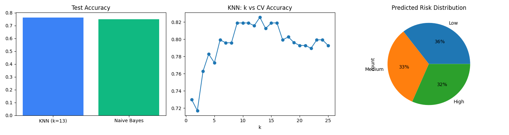

# Student Academic Performance Prediction: KNN vs Naive Bayes

> Early-warning system that predicts Low / Medium / High academic performance using KNN and Naive Bayes.

## Aim
To build and compare K-Nearest Neighbours (KNN) and Naive Bayes classifiers that predict student performance bands (Low / Medium / High) from absences, study time, failures and earlier grades, and to deliver the results as an early-warning report and charts for mentors.

## Problem Statement
Many students fall behind academically before anyone notices. This project builds a model to identify at-risk students early, so mentors can step in on time.

## Features
- Data cleaning: duplicate removal, missing value handling, outlier capping (fitted on training data only)
- Final grade (G3) binned into **Low / Medium / High** performance bands
- KNN and Gaussian Naive Bayes models with feature scaling
- 5-fold cross-validation and KNN `k` tuning (best k is used in the final model)
- Model selection by cross-validation; test set used once for evaluation
- Accuracy, classification report, and confusion matrix for both models
- Early-warning output: at-risk students ranked by risk probability

## Dataset
**Student Performance Dataset** (math course, secondary school survey, 395 students) from Kaggle, by Dev Ansodariya: https://www.kaggle.com/datasets/devansodariya/student-performance-data

File used: `student_data.csv`

| Column | Description |
|---|---|
| absences | Number of school absences (attendance indicator) |
| studytime | Weekly study time (1 to 4) |
| failures | Number of past class failures |
| G1 | First period grade (0 to 20) |
| G2 | Second period grade (0 to 20) |
| G3 | Final grade (0 to 20), used to create the target bands |

## Tech Stack
Python, pandas, NumPy, scikit-learn, Matplotlib

## Project Structure
```
├── student_performance_knn_nb.py   # main script
├── student_data.csv                # dataset
├── mentor_alerts.csv               # at-risk student list
├── mentor_dashboard.png            # result charts
└── README.md
```

## Installation
```bash
git clone https://github.com/Fathima1616/student-performance-knn-naive-bayes.git
cd student-performance-knn-naive-bayes
pip install pandas numpy scikit-learn matplotlib
```

## Usage
```bash
python student_performance_knn_nb.py
```

## Methodology
1. Load student data
2. Convert final grade G3 into three performance bands (Low / Medium / High)
3. Split data 80/20 (stratified)
4. Clean data using training-set statistics only (missing values, outlier capping)
5. Tune k for KNN using 5-fold cross-validation on the training set
6. Train KNN (best k) and Naive Bayes with standard scaling
7. Select the best model by cross-validation accuracy
8. Evaluate once on the test set
9. Generate the mentor early-warning report and charts

## Output
- `mentor_alerts.csv`: students flagged as Low performers, ranked by risk %
- `mentor_dashboard.png`: model accuracy comparison, KNN k-tuning curve, predicted risk distribution

## Results
| Model | CV Accuracy | Test Accuracy |
|---|---|---|
| KNN (k=13) | 0.826 | 0.763 |
| Naive Bayes | 0.832 | 0.750 |

**Best k for KNN:** 13 (from cross-validation tuning)
**Best model (selected by CV):** Naive Bayes
**At-risk students flagged:** 27 out of 76 test students

## Observations
- Both models perform similarly. Naive Bayes had slightly higher CV accuracy (0.832 vs 0.826), while KNN had slightly higher test accuracy (0.763 vs 0.750). The test difference is about one student out of 76, so neither model is clearly better.
- **High** and **Low** bands are predicted better (F1 about 0.77 to 0.86). The **Medium** band is hardest (F1 0.63 to 0.67) because it overlaps with both neighbouring groups.
- Naive Bayes had the best performance on the High band (F1 0.86).

## Dashboard


## Limitations
- The dataset is small (395 students), so results can vary with a different split.
- G1 and G2 are earlier grades that are strongly related to the final grade G3, which makes prediction easier. A real early-warning system would need to work before these grades are available.
- The dataset has `absences` but no direct assignment-submission data, so `absences` and earlier grades are used as proxies for attendance and assignment performance.
- The dashboard is a static chart image, not an interactive application.

## Future Work
- Live dashboard using Streamlit
- Try more models (Random Forest, SVM)
- Tune hyperparameters with GridSearchCV
- Predict without G1 and G2 for earlier warnings
- Validate with real institutional LMS data

## Author
**Shaik Fathima Bee** (23ME1A5460)
Guide: Mr. R. Sri Ramu
Course: Machine Learning & Predictive Analytics
